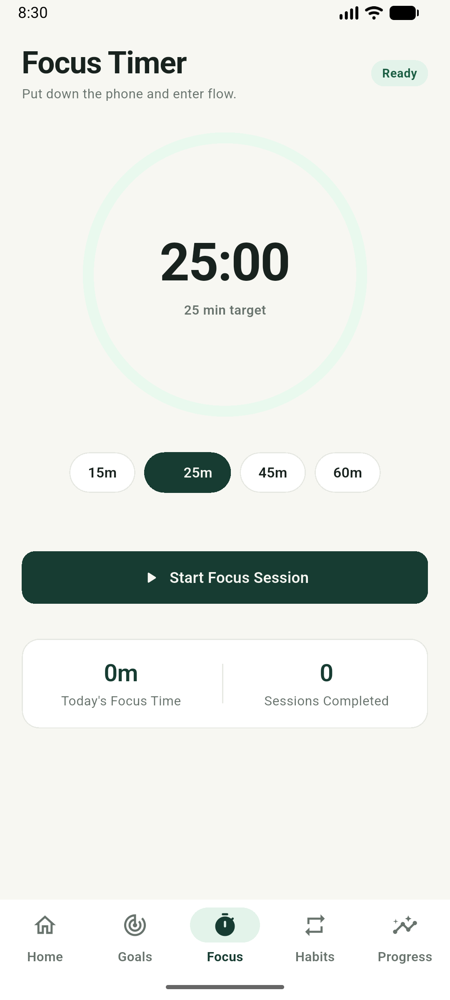
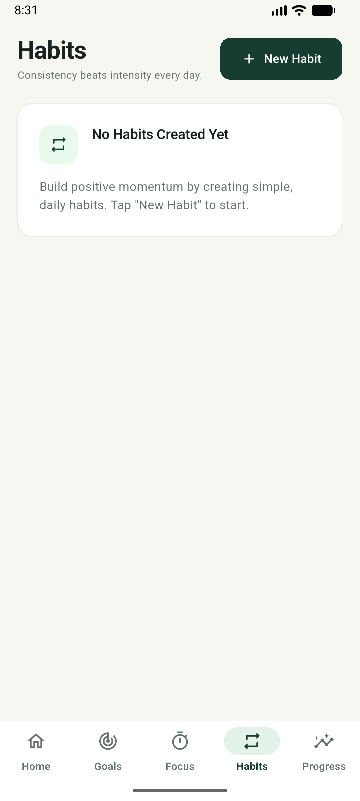
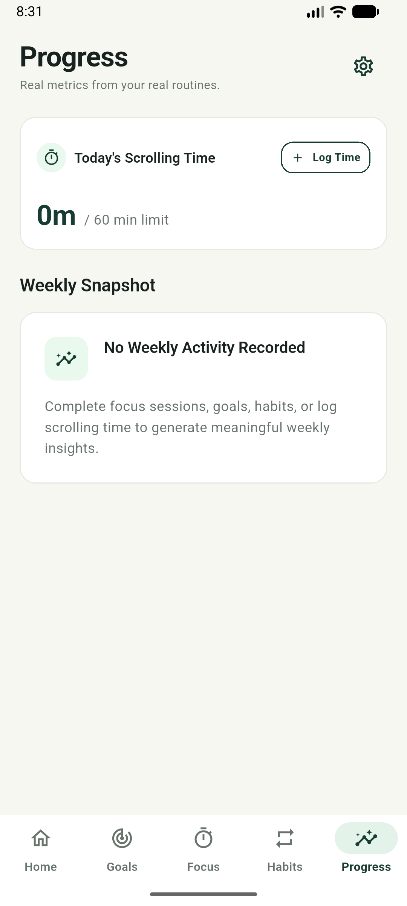
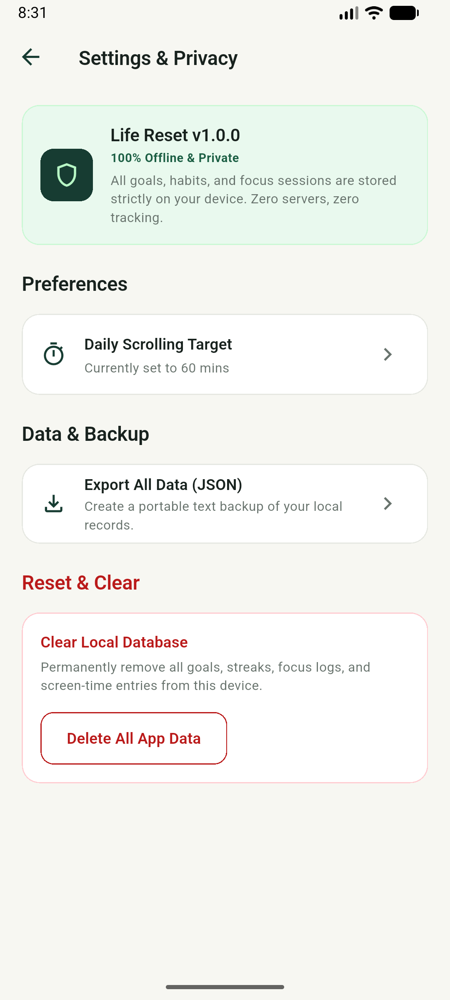

# Life Reset — Scroll Se Goal Tak

> **Scroll less, achieve more.** A minimal, distraction-free productivity app designed to break unintentional scrolling loops and channel your daily focus toward real-life goals.

[](https://flutter.dev)
[](https://dart.dev)
[](https://www.android.com)
[-green)](#android-configuration)
[](#privacy--architecture)

---

## 🎯 Product Mission & Vision

Social media algorithms are designed to capture and hold your attention. **Life Reset** helps you reclaim your time and energy through intentional focus, atomic habits, and daily goal clarity:

- **Target Audience:** Students preparing for exams, job seekers mastering new skills, working professionals, and anyone striving for greater daily discipline.
- **Philosophy:** Practical progress over vanity metrics. No gamified noise, no ads, no paywalls.

---

## 📱 Core Features

1. **Daily Priorities (Rule of 3):** Focus on what matters most today. Set up to 3 core daily priorities, tick them off, and track active vs. completed goals.
2. **Atomic Habits & Streaks:** Build long-term consistency with real calendar-day streak tracking. Handles yesterday-completion grace periods and records personal bests.
3. **Flow Focus Timer:** Pomodoro-style timer (15, 25, 45, or 60 min presets) with real-time countdown, pause/resume, goal tagging, and session auto-recovery across app restarts.
4. **Scrolling Awareness:** Manually log social media time, compare it against your daily scrolling budget, and receive gentle threshold alerts.
5. **Weekly Insights Dashboard:** Visual balance of focus minutes versus scrolling time across the last 7 days.
6. **Data Portability & Double-Confirm Wipe:** Full JSON data backup directly copied to clipboard, plus double-confirmed local data erasure.

---

## 🔒 Privacy & Architecture

Life Reset is built on a **local-first, zero-knowledge privacy architecture**:
- **100% Offline:** The app declares **zero network permissions** in `AndroidManifest.xml` (`android.permission.INTERNET` is completely absent).
- **Local SQLite Storage:** All goals, habit completions, focus sessions, and screen-time logs reside strictly inside the local SQLite database (`sqflite`).
- **Zero Third-Party Tracking:** No Firebase, no Google Analytics, no ads SDKs, no external crash reporters, and no user accounts.
- **Data Export:** Backups are formatted as portable JSON and copied strictly to the local device clipboard upon user request.

---

## 📸 Screenshots

| Home & Priorities | Focus Timer | Habits & Streaks |
| :---: | :---: | :---: |
|  |  |  |

| Weekly Progress | Settings & Privacy | Keyboard Avoidance |
| :---: | :---: | :---: |
|  |  |  |

---

## 🛠️ Tech Stack & Requirements

- **Flutter SDK:** `^3.47.7` (Channel stable)
- **Dart SDK:** `^3.13.5`
- **JDK:** OpenJDK 17 or higher
- **Android SDK:** Compile SDK 36, Target SDK 36, Min SDK 24 (Android 7.0 Nougat+)
- **Key Packages:**
  - `sqflite` — Local relational SQLite database
  - `shared_preferences` — Lightweight local preferences
  - `intl` — Date formatting and calendar math
  - `uuid` — Cryptographically unique record identifiers

---

## 🚀 Getting Started & Setup

### 1. Clone the Repository
```bash
git clone https://github.com/1amjadali1/LifeReset.git
cd LifeReset
```

### 2. Install Dependencies
```bash
flutter pub get
```

### 3. Run Code Verification & Tests
Ensure all analyzer checks and automated tests pass:
```bash
# Verify formatting
dart format --output=none --set-exit-if-changed .

# Static code analysis
flutter analyze

# Run complete test suite (37 tests)
flutter test
```

### 4. Run on Device or Emulator
Ensure an Android emulator or USB-debugging device is connected:
```bash
flutter devices
flutter run
```

---

## 📦 Build Instructions

### Debug Build
```bash
flutter build apk --debug
```
Output: `build/app/outputs/flutter-apk/app-debug.apk`

### Architecture-Specific Release APKs (Smallest download size)
```bash
flutter build apk --release --split-per-abi
```
Outputs:
- `build/app/outputs/flutter-apk/app-arm64-v8a-release.apk` (~18 MB, modern 64-bit phones)
- `build/app/outputs/flutter-apk/app-armeabi-v7a-release.apk` (~15 MB, 32-bit legacy phones)
- `build/app/outputs/flutter-apk/app-x86_64-release.apk` (~19 MB, Intel emulators)

### Google Play Production App Bundle (AAB)
```bash
flutter build appbundle --release
```
Output: `build/app/outputs/bundle/release/app-release.aab` (~49.5 MB multi-ABI container). When installed via Google Play, Dynamic Delivery delivers only the required ~18 MB architecture slice to the user.

---

## 🔐 Release Signing Security Warning

> [!IMPORTANT]
> **Production Signing Credentials:**
> - Never commit `key.properties` or any `*.jks`/`*.keystore` files to version control.
> - A safe template is provided at [`android/key.properties.example`](android/key.properties.example).
> - When ready for production release, generate your private upload keystore locally using JDK `keytool`, store it in a secure location, and back it up externally.
> - If `key.properties` is not present, the Android build gracefully falls back to local test signing for safe development.

---

## 📋 Google Play Release Checklist

For detailed release procedures, store listing metadata, Data Safety questionnaire answers, and testing track requirements, see:
👉 [Google Play Store Release & Submission Guide](docs/play_store_release_checklist.md)

---

## 📄 Honest Limitations

- **Single Device:** Since the app is 100% offline with no server backend, data does not automatically sync across multiple phones. Users should use the JSON Export tool to manually back up their records.
- **Manual Social Media Logging:** Social media app usage is logged manually by the user to respect privacy and avoid demanding intrusive Android UsageStats / Accessibility permissions.

---

## 📝 License & Authors

Created with focus and discipline by **Amjad Ali** (`1amjadali1`).
All rights reserved.
